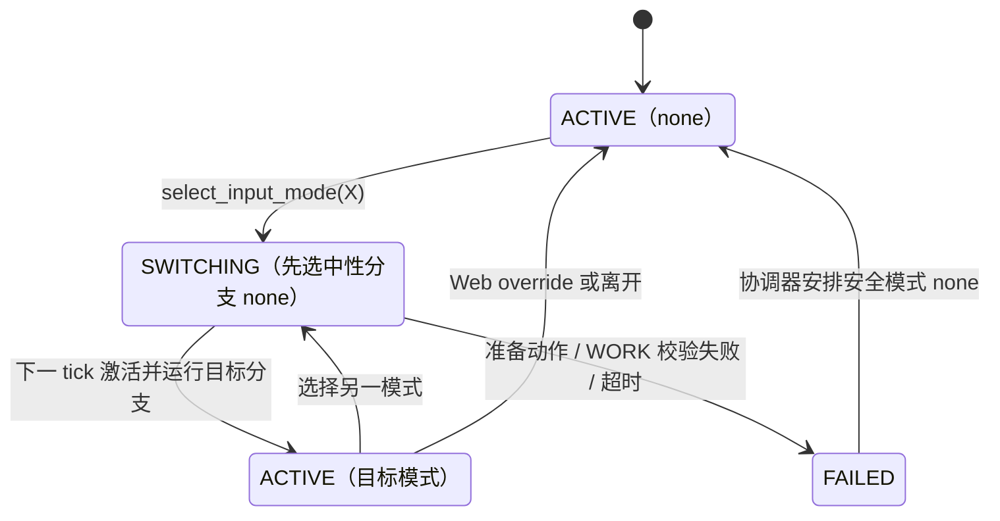

# 行为树控制权与 Mock 测试

行为树运行时位于 `realman_bt`，底层仍使用 RealMan Action 和
`motion_coordinator`。持久输入路由器的权威定义是
[`config/behavior-trees/control.xml`](https://github.com/QingTianRobot/realman_pi/blob/main/config/behavior-trees/control.xml)：
当前目录顺序为 `web`、`keyboard`、`policy`、`pikaposition`、`pikavelocity`、`pikamixed`、`none`。其中
`keyboard`、`policy`、`pikaposition`、`pikavelocity`、`pikamixed` 和 `none` 可由浏览器选择器请求；`web`
是粘性且最高优先级的覆盖，不出现在浏览器选择器中。
ROS selection service 接受任何已注册模式（包括 `web`），只要求调用者提供非空 `requester_id`；
该字段用于请求关联，并非 service 层的身份验证或授权。
`keyboard` 分支固定为 `InputModeGuard` → 有状态 `keyboard_entry` →
`PrepareKeyboardWork` → `ActivateInputMode` → `KeyboardVelocityInput`。该叶节点和
Policy/Pika 输入叶一样保持 `RUNNING` 并记录控制权；实际键盘速度 session 由同一 launch 中的
`keyboard_control_router` 管理，Pika topic 转发由 `pika_control_router` 管理。两个 router 都只为 l/r
建立 session，绝不为 m 建立 goal、订阅或 command publisher。

选择器显示 `Pika / 位置控制`（模式 ID `pikaposition`）、`Pika / 速度控制`（模式 ID
`pikavelocity`）和 `Pika / Mixed 控制`（模式 ID `pikamixed`）三个独立选项。Pika 生产 topic 为 `/pika/l|r/cartesian_pose`（`PoseStamped`）
和 `/pika/l|r/cartesian_velocity`（`TwistStamped`）；位置数据使用各臂 BASE frame（`l/base_link`、
`r/base_link`），速度数据使用已验证的 identity WORK frame（`l/work/pikabase`、`r/work/pikabase`）。
键盘仍要求已验证的默认 `l/work/cell`、`r/work/cell`。夹爪开合度由 `/pika/l|r/gripper_percentage`
（`std_msgs/msg/Float32`）持续发布，范围是 `0.0..1.0`（`0` 闭合，`1` 张开）。Pika 只控制
l/r，绝不订阅或发送 m 的夹爪信号。

`InputModeGuard` 的 `mode`、`label`、`selectable` 字面量在 XML 构造时注册目录，
因此新增模式只改 XML 和相应叶注册，不能在 Web 或 Python 写静态枚举。路由根节点必须保留
`ReactiveSequence` 和 `ReactiveFallback`，使 guard 每个 10 Hz tick 都重算并 halt 离开的
RUNNING 分支。普通分支（`web`、`none`）是 `InputModeGuard` → `ActivateInputMode` → 输入叶；keyboard 分支在激活前
调用 `/l/coordinates/select_work` 和 `/r/coordinates/select_work`，请求名称来自坐标注册表中的
`l|default_work`、`r|default_work`，而不是在行为树中硬编码 `cell`。两个响应都必须返回
`success=true` 且 `active_name` 与各自的配置名称一致，随后才发布 `ACTIVE/keyboard`。
任一 service 拒绝、异常或读回名称不一致都会让切换进入 `FAILED`，现有协调器下一拍安排安全模式
`none`；因此浏览器不会在错误 WORK 下取得 keyboard lease。`dry_run=true` 时仍验证左右臂默认引用
存在且类型为 WORK，但不创建 service client，也不改变控制器坐标。Pika 分支在激活前
额外运行一次有状态 `Sequence` 中的 `ThreeArmMoveJ` 准备动作，准备成功后才发布 Pika `ACTIVE`。
准备动作成功后，后续 tick 会从该 `Sequence` 的 Pika 输入叶继续，不会重新进入准备动作；只有离开
Pika 分支后再次进入，才会重新执行准备动作。

`policy` 分支用同样的结构：有状态 `policy_entry` → `ThreeArmMoveJ`（节点名 `policy_start_pose`，速度 `10%`，比 Pika 的 `30%` 慢）→ `ActivateInputMode` → `Fallback policy_task`。目标位姿沿用 `pika_default_pose`（launch 从 `pika_config.yaml` 注入 `pika_{l,m,r}_joint_degrees`，不在 XML 里复制），原因有二：训练数据的 130 个 episode 都从这个位姿起步（各关节离散度不超过 1°），策略必须从它见过的状态开始；速度会话开始前的 `passthrough_reanchor_mode: canfd_current` 重新锚定只挂在 MoveJ 之前，没有这一步就得不到该保护。回位成功才发布 `ACTIVE/policy`，`dry_run=true` 时只校验、不发动作。回位成功、`ACTIVE/policy` 发布之后，任务由行为树自己监督：`GripperReady`、再次回位、`PolicyRun`（激活桥接、监督、停止）包在 `Repeat` 和 `RetryUnlessFault` 里，失败经 `FailInputMode` 进入 `FAILED`。细节见 [Policy 任务](./policy-task)。配置 `activation: auto`（默认）时选择 `policy` 就会开始运行，`operator` 时仍等待操作员调用 `/policy/activate`。三条臂都会回位，与 Pika 一致，也与数据采集时的布局一致。

键盘 Web ingress 是 `/keyboard/l/cartesian_velocity` 和 `/keyboard/r/cartesian_velocity`
（`geometry_msgs/msg/TwistStamped`）。`keyboard_control_router` 为左右臂分别拥有
`/l|r/cartesian_velocity` Action，并在 session 接受后向
`/l|r/cartesian_velocity/command` 刷新命令。两臂互不绑定：一侧没有按键、WORK 不可用或输入超时，
只释放该侧，不影响另一侧仍满足条件的 session。

键盘只允许每臂当前已验证的默认 WORK 坐标：坐标状态必须同时确认 `motion_allowed=true`、
`work_matched=true`、当前/预期 WORK 名称及 frame ID 都与
[`config/ros/realman_coordinates.yaml`](https://github.com/QingTianRobot/realman_pi/blob/main/config/ros/realman_coordinates.yaml) 一致。Goal 固定使用
`CartesianVelocity.Goal.WORK`；BASE 被拒绝，也不会在 WORK 不可用时自动回退到 TOOL。
`/<arm>/coordinates/state` 使用 reliable、transient-local、depth 1 QoS，驱动保留最近一次校验结果，
并按 `config/ros/realman_driver.yaml` 的 `coordinate_state_publish_rate`（生产默认 `1.0 Hz`）低频重发。
这同时覆盖控制器连接后首个样本早于 DDS endpoint discovery 的生产启动时序，使晚启动的 Web control 和
`keyboard_control_router` 无需人工调用 `coordinates/verify` 即可恢复 WORK gate。publisher/subscriber
任一侧改回 volatile，或移除周期重发，都会破坏这个启动顺序契约。

切换到不同模式时，选择先进入 `SWITCHING` 并选择 `none`。下一 tick 必须激活/运行这个中性分支，
下一 tick 才选择并激活目标模式；这让 Policy/Pika 不必自行结束即可交接。重选已经 active 的模式会
立即返回已有 request ID，不经过中性 tick，`epoch` 也不会递增。Web 离开到非 Web 模式时，桥先取消
所有 Web-owned Action：等待尚未返回的 goal response 被拒绝、Action 已终结，或取消成功提交，
再请求全局模式。取消提交异常会重试；不等待取消确认或机械臂物理停止。
Web 运动也只有收到同一请求的 `ACTIVE/web` 后才会转发。键盘模式同样经过 `none` 中性交接，并且只有
请求它的 WebSocket 在收到匹配的 `ACTIVE/keyboard` 后取得独占 lease；其它浏览器的按键消息会被拒绝。

## 输入路由 ROS 契约
选择与切换的状态流转（`phase` 取值 `ACTIVE` / `SWITCHING` / `FAILED`）：




路由器运行时由 `realman_bt_executor` 提供两个 service 和一个可靠、transient-local topic：

| 名称 | 类型与字段 | 用途 |
| --- | --- | --- |
| `/realman_bt_executor/list_input_modes` | `realman_msgs/srv/ListInputModes`：响应 `success`、`message`、并行的 `mode_ids`、`labels`、`selectable` 数组 | 以 XML 声明顺序发现目录。 |
| `/realman_bt_executor/select_input_mode` | `realman_msgs/srv/SelectInputMode`：请求 `mode_id`、`requester_id`；响应 `accepted`、`request_id`、`message` | 请求一个已注册模式。 |
| `/realman_bt_executor/input_mode_state` | `realman_msgs/msg/InputModeState`：`requested_mode`、`selected_mode`、`active_mode`、`phase`、`request_id`、`epoch`、`detail` | 发布 `ACTIVE`、`SWITCHING` 或 `FAILED` 的路由状态。 |

`detail` 说明当前状态的原因：`FAILED` 时是失败原因；协调器随后切到 `none` 时，`SWITCHING` 和之后的
`ACTIVE/none` 都带着 `<失败的模式> failed: <原因>`（例如 `policy failed: joint J5 = 19.6 deg is outside [15.0, 108.2]`）；
有人主动请求 `none` 时是 `requested by <requester_id>`。这个说明一直保留到下一次切换，再次请求任何模式时清空，
因此切回 `policy` 不会再显示上一次的错误。executor 的 `input mode active: ...` 日志行末尾也会打印它。

配置在 [`config/ros/behavior_tree.yaml`](https://github.com/QingTianRobot/realman_pi/blob/main/config/ros/behavior_tree.yaml)：
`tick_rate_hz: 10.0`（Hz）、`switch_timeout_ms: 5000`（ms），以及必须是已注册且可选模式的
`safe_fallback_mode: none`。`none` 既是安全回退也是中性 tick，不能删除或改成 Web。

键盘按键、速度比例和 Web 输入时序的权威配置是
[`config/ros/keyboard_control.yaml`](https://github.com/QingTianRobot/realman_pi/blob/main/config/ros/keyboard_control.yaml)。浏览器每 `50 ms` 发送一次
左右臂各自的完整按键集合；Web bridge 对每臂要求严格递增的 sequence，并拒绝未知物理键码、重复键码、
非 lease owner 和任何 m 输入。keyboard router 缓存最新有效输入，并按 `config/ros/realman_motion.yaml`
的 `10 ms` 周期刷新 driver；driver 仍用 `100 ms` watchdog 执行第二层失效保护。

键盘速度 Goal 固定使用 `follow=true`（RealMan SDK 高跟随模式），并在创建 Goal 时拒绝任何大于
`10 ms` 的配置周期。浏览器仍每 `50 ms` 上报完整按键集合，router 将输入采样与 SDK 刷新解耦，
由 driver 固定周期 worker 按 `10 ms` 执行最新命令。生产 A/B 测试中，旧的 `20 ms + follow=false`
组合在启动阶段出现明显的非指令轴瞬态，因此不能恢复为键盘默认配置。

#### 一次键盘激活只有一个速度 session

每条臂的速度 session 生命周期跟随**模式**，而不是跟随按键：

| 事件 | 行为 |
| --- | --- |
| 进入 `ACTIVE/keyboard`、WORK 已验证、浏览器心跳到达 | **立即**建立 session（选 WORK、`rm_set_movev_canfd_init`），持续刷新零速度；第一次按键不再等待 Goal 接受和初始化 |
| 按键、松键、换方向 | 只改变命令，session 不变；换向和停止由 driver 的加速度限幅平滑过渡 |
| 心跳晚于 `input_timeout_ms`（`150 ms`） | 刷新零速度让机械臂停下，**保留** session；短暂网络卡顿不触发重新初始化 |
| 心跳晚于 `input_lost_ms`（`1000 ms`，浏览器关闭、失焦或页面隐藏） | 发布零速度并取消 session；页面恢复后立即重新建立 |
| 离开 `keyboard`、WORK 失配、非法输入、router 关闭 | 发布零速度并取消 session |
| driver 拒绝或自行结束 session | 等待 `0.5 s` 再重试，不按 `10 ms` 周期反复请求 |

两个时限均来自 `config/ros/keyboard_control.yaml`，`input_lost_ms` 必须大于 `input_timeout_ms`。

之所以不在松键时取消：每次取消都会下发一帧**未经加速度限幅**的零速度并调用 `rm_set_arm_slow_stop`，
下一次按键再重新 `rm_set_movev_canfd_init`。松键后机械臂实测还会滑行约 1.8 s，重新初始化往往落在仍在运动的
机械臂上，而 session 启动正是上面 A/B 测试里出现非指令轴瞬态的时刻；随时换向的键盘操作因此会反复出现
跑偏和跟踪滞后。

router 记录每次激活以来打开的 session 数：第一个以 info 记录，之后每次重开都以 warning 记录为
`restart #N`。正常操作一次激活只应出现一个；出现 restart 说明有东西在打断 session，应先排查它。

代价是键盘模式激活且页面在前台期间，左右臂一直被速度 session 占用，其它运动请求（如 Web 关节运动）会被
driver 以 ownership 忙拒绝；离开键盘模式或页面失焦超过 `input_lost_ms` 即释放。

如果停止条件发生在 Action goal response 返回之前，router 设置 `cancel_after_accept`；迟到接受的 goal 会立即
取消，不能成为 active session。浏览器 owner 断开还会释放 lease 并请求安全模式 `none`。`dry_run=true` 时
仍校验模式、WORK、配置和输入，但不发送 driver Goal，也不发布 driver command。`control_period_ms` 大于
`10 ms` 的配置会在 router 启动时被拒绝，而不是在第一次按键时让 router 崩溃。

切入 `ACTIVE/keyboard` 后，Web 控制台会在 URDF 查看区同时绘制左右臂可用的 WORK 坐标轴：
X/Y/Z 分别为红/绿/蓝，轴的位姿来自驱动回传的 `work.xyz_m` 与 `work.quaternion_wxyz`，再叠加
`three_robots.yaml` 中该臂的 world 安装变换。离开 keyboard 或某臂 WORK 校验失效时，对应坐标轴立即隐藏；
画面不会用静态默认值伪装成可控制坐标。

同一 keyboard 分支还支持左右夹爪的单次全开／全闭：左 `1/2`、右 `9/0`，与速度键独立。
Web bridge 检查 lease/sequence 并识别新按下边沿，发布 `/keyboard/l|r/gripper_command`
（`std_msgs/msg/String` JSON：`command`、`epoch`、`request_id`、`stamp_ns`）。router 只在
`ACTIVE/keyboard`、epoch/request 匹配、事件未重复且在 `input_timeout_ms` 内、对应夹爪在线且无报警时，
转发 `Float32` 到 `/gripper_left|right/percentage/command`；`1.0` 全开、`0.0` 全闭。
夹爪不依赖 WORK，也不建立机械臂 Action。`dry_run=true` 消费事件但不输出；非活动、旧 epoch、健康拒绝事件不重放。
松键／模式离开不会取消已提交夹爪目标，更不能向夹爪发送零值来模拟停止。详见
[键盘夹爪契约](./gripper-control#键盘双夹爪全开-全闭)。原 ReactiveFallback 和 `KeyboardVelocityInput` 无需新分支。

同一 launch 还启动 `pika_control_router`，只为 l/r 管理 Pika 的位置、速度和 Mixed 三种 session，并转发 Pika 夹爪
百分比。门控、保持规则、限值、Mixed 模式的牵引约束、准备动作、发送端消息规范和 rosbag replay 都在
[Pika 遥操作](./pika-teleop)。这里只保留与输入路由相关的约束：`dry_run=true`（默认）时 router 不发送机器人
Action 或夹爪 command，需要真实 Pika 运动必须显式设置 `REALMAN_BT_DRY_RUN=false`，并完成低速、急停和
工作区检查；切入任一 Pika 模式前，行为树先运行一次 `ThreeArmMoveJ` 准备动作到
`config/ros/pika_config.yaml` 的 `pika_default_pose`，准备失败或被取消时不会进入 Pika `ACTIVE`。

## 任务控制节点

每个节点的语义、端口和可交互的树浏览器、逐拍模拟见 [行为树节点参考](./behavior-tree-nodes)。

除了输入路由用到的 `Sequence`、`ReactiveSequence` 和 `ReactiveFallback`，执行器还注册了
一组控制"重复和重试"的节点，供一个分支里的有限任务使用：

| 标签 | 端口 | 语义 |
| --- | --- | --- |
| `Fallback` | 无 | 有状态的优先级列表：依次尝试子节点，第一个 `SUCCESS` 即成功，全部失败才失败；与 `ReactiveFallback` 不同，已在 `RUNNING` 的子节点不会被重新评估 |
| `Repeat` | `num_cycles`（默认 1，`-1` 无限） | 子节点每成功一次计一轮，达到轮数返回 `SUCCESS`；子节点失败则整体失败。每一轮之间会 `halt()` 子节点 |
| `Retry` | `num_attempts`（默认 1，`-1` 无限） | 子节点失败时 `halt()` 后重跑，次数含首次；`RUNNING` 不消耗次数 |
| `MotionDwellMonitor` | `arm_id`、`dwell_sec`、`tolerance_deg`、`on_dwell` | 子节点运行时，指定的臂在同一姿态停留超过 `dwell_sec` 就 `halt()` 子节点并返回 `on_dwell`（默认 `FAILURE`），见 [动作停留监控](#动作停留监控) |
| `RetryUnlessFault` | `num_attempts`（默认 1，`-1` 无限）；`timeout_attempts`（默认 0，`-1` 无限）；`timeout_backoff_sec`（默认 0） | 同 `Retry`，但失败的叶节点若已把黑板键 `policy_fault` 置为 `true`，立即返回 `FAILURE`，不再消耗剩余次数；若置位的是 `policy_timeout`，且 `timeout_attempts` 不为 0，则这次失败不占 `num_attempts`，改按 `timeout_attempts` 计数，并在等待 `timeout_backoff_sec` 后重试 |

`policy_fault` 用来区分"值得再试一次"和"再试也没用"：抓空、超时属于前者，叶节点什么都不用写；
关节越界、必需服务缺失属于后者，叶节点在返回 `FAILURE` 之前把它置为 `true`。这个标志属于
`RetryUnlessFault` 的一次运行：运行开始时和 `halt()` 时清除，所以上一次留下的故障不会挡住新的
第一次尝试；某次运行以故障结束后，标志保持置位，上层仍能读到。

`policy_timeout` 是第三类失败，表示策略服务或桥接超时（推理连续超时导致桥接自行暂停、统计中断、
预检时桥接迟迟未就绪、激活无回应）。这类问题多为暂时性的，因此单独计数：等待期间返回 `RUNNING`，
不 tick 子节点；计数用完后，在 `policy_failure_reason` 前加上 `policy server timed out N times; last: `，
再返回 `FAILURE`。`timeout_attempts` 为 0（默认）时，超时按普通失败处理，不等待。这个标志和
`policy_fault` 一样，在运行开始和 `halt()` 时清除，在每次超时重试前也会清除。生产树的计数和等待时间
来自 `policy_task.yaml` 的 `timeout_retry`，见 [Policy 任务](./policy-task#策略服务超时重试)。

因为 `Repeat` 和 `Retry` 在每次重来之前都会 `halt()` 子树，子树里的叶节点必须在 `onHalted()` 里
把自己停干净，并允许被重复 `halt()`。

## 动作停留监控

`MotionDwellMonitor` 是一个装饰节点，用来处理"机械臂长时间停在同一个姿态"的情况，例如策略输出接近零、遥操作中断、某个输入卡住。它包住一棵子树，只读取一条臂的 `/<arm>/joint_states`。子树运行期间，如果这条臂的六个关节始终在 `tolerance_deg` 以内，持续达到 `dwell_sec`，它就 `halt()` 子树并返回 `on_dwell`。外层的 `Fallback` 随即转去执行下一个分支，例如回位、张开夹爪或交给另一种控制方式。它本身不发送任何运动指令。

| 端口 | 默认值 | 说明 |
| --- | --- | --- |
| `arm_id` | `r` | 监视哪条臂：`l`、`m` 或 `r` |
| `dwell_sec` | `motion_monitor.yaml` 中的 `dwell_sec`（30 s） | 允许停留的最长时间 |
| `tolerance_deg` | `motion_monitor.yaml` 中的 `tolerance_deg`（0.5°） | 任一关节偏离停留姿态超过该值，就算在动，重新计时 |
| `on_dwell` | `failure` | 触发时返回 `failure` 还是 `success` |

计时规则：

- 每次运行开始时（节点从空闲、被 `halt()` 或上次结束后再次被 tick）重新计时，之前的停留不计入。
- 以第一次读到的姿态为基准。某个读数中任一关节偏离基准超过 `tolerance_deg` 时，基准移到这个读数，并重新计时。因此慢速漂移累计超过容差后同样算作在动。
- `joint_states` 中断超过 `joint_state_stale_sec` 时，下一次读数重新计时；没有数据时永远不会触发。也就是说，没有观测到的时间不算停留。
- 子树先结束时（`SUCCESS` 或 `FAILURE`），它原样返回子树的结果。
- 触发时把 `motion_dwell` 置为 `true`，并写入 `motion_dwell_reason`（例如 `arm r stayed within 0.50 deg of one pose for 30.0 s (limit 30.0 s)`），同时在运行快照中记一条 `WARN` 事件。

默认值位于 [`config/ros/motion_monitor.yaml`](https://github.com/QingTianRobot/realman_pi/blob/main/config/ros/motion_monitor.yaml)，由 `control_router.launch.py` 作为执行器参数加载，执行器再写入黑板。XML 中写了端口，就以端口为准；修改 YAML 后需要重启 `./rm65 bt`。驱动静止时的关节读数抖动约为 0.004°，所以 0.5° 的容差足以区分"静止"和"缓慢但有意义的运动"。

### 用法示例

生产树 `control.xml` 目前**没有**使用这个节点。要启用它，需要把要监视的子树包起来，再在外面加一个 `Fallback`，用来指定触发后切换到哪个分支。

例 1：policy 尝试中，右臂停住超过 15 s 时提前结束这次尝试（不必等到 45 s 的 `max_attempt_sec`），交给 `RetryUnlessFault` 重试，下一次尝试会先张开夹爪、再回位：

```xml
<Sequence name="policy_attempt">
  <GripperReady arm_id="r" dry_run="{dry_run}"/>
  <ThreeArmMoveJ name="policy_rehome" .../>
  <MotionDwellMonitor arm_id="r" dwell_sec="15">
    <PolicyRun arm_id="r" task="place" dry_run="{dry_run}"/>
  </MotionDwellMonitor>
</Sequence>
```

`PolicyRun` 被 `halt()` 时会立即发出停止调用（`deactivate` 和两个急停），因此提前结束是安全的。由于 `policy_fault` 没有置位，这次结束算作一次普通的失败尝试。

例 2：在 Pika 速度控制分支里，右臂 60 s 不动就退出该模式，由协调器切换到安全模式 `none`（形态切换）：

```xml
<Sequence name="pika_velocity_entry">
  <ThreeArmMoveJ name="pika_default_pose" .../>
  <ActivateInputMode mode="pikavelocity"/>
  <Fallback name="pika_or_leave">
    <MotionDwellMonitor arm_id="r" dwell_sec="60">
      <PikaVelocityInput/>
    </MotionDwellMonitor>
    <FailInputMode reason="{motion_dwell_reason}"/>
  </Fallback>
</Sequence>
```

输入叶节点始终返回 `RUNNING`，因此只有 `MotionDwellMonitor` 能结束第一个分支。`FailInputMode` 把输入模式标记为 `FAILED`，原因取自 `motion_dwell_reason`，协调器随后切换到 `none`，路由也随之停止转发。不要在模式仍然激活时，在同一分支里接 `ThreeArmMoveJ` 回位：这时 router 可能仍持有速度会话，两者会互相争夺控制。需要回位时，先离开该模式，再从 Web 选择下一个模式，各分支的入口都会先回位。如果只想要"停住就进入下一步"，把 `on_dwell` 设为 `success`，然后放进 `Sequence` 即可。

### 试用（不部署）

1. 改树：把上例写进一个新的 XML，或者写进本地副本的 `control.xml`。不要直接改 realman_ts 主机上的文件。
2. 无硬件验证：用模拟驱动或 `REALMAN_BT_DRY_RUN=true ./scripts/bt.sh control` 加载树，确认它能解析。端口写错（`arm_id` 不是 l/m/r、`on_dwell` 不是 failure/success、`dwell_sec` ≤ 0）时，第一次 tick 就会报错。dry-run 下驱动不发布 `joint_states`，这时节点永远不会触发。
3. 上真机前，先把 `dwell_sec` 设得短一些，例如 5 s，并有人手持急停，观察运行快照中的 `dwell` 事件和 `motion_dwell_reason`，再恢复为正式的取值。

## 生命周期和无硬件验证

`./rm65 up` 只拥有长期 driver 和 :8765 Web 服务；它不启动行为树。只要 Docker 中已经有一个运行中的
`realman_bringup_remote` 容器，就可以显式执行 `./rm65 bt control`；该命令使用
`control_router.launch.py` 和 `exit_on_terminal=false`，连同 :8080 只读监视器持续到 Ctrl-C。
运行期间 :8765 控制页的“行为树”卡片显示当前输入分支的实时状态（见 Web 控制页的“行为树视图”）。
启动器按 Docker 的 `com.docker.compose.service=realman_bringup_remote` 标签查找唯一运行中的 driver
容器，再通过容器 ID 执行 `bt-start`，因此不依赖 `./rm65 up` 或当前 Compose project；没有或多于一个匹配
bringup 时会拒绝启动，避免把控制树接入错误的驱动图。Ctrl-C 不停止 driver；`./rm65 down` 才停止统一运行时。

## 独立测试

```bash
./rm65 bt-test all       # 无 ROS 依赖的 XML 与 mock 契约
./rm65 bt-test build     # 构建 realman_msgs/realman_bt/realman_bt_mock
./rm65 bt-test mock      # 启动 /realman/mock/* 隔离 ROS 图
./rm65 bt-test web       # 启动 Compose 行为树调试服务
```

`./rm65 bt control` 的 Ctrl-C（非交互运行也可向 CLI 发送 SIGINT）按本次调用的唯一 token
通知对应容器 wrapper。wrapper 先调用 `/realman_bt_executor/stop`，让 executor halt 行为树并由独立
timer 提交所有未完成 Action 的取消请求；快照中的 `pending_cancellations` 归零后才终止本次 ROS
launch/executor 进程组、停止监视器、归档 runtime snapshot 并释放锁。若取消在 10 秒内未清空，wrapper
会打印警告并强制清理；CLI 返回 130。其他 driver 和其他容器保持运行。

启动同样可以在 :8765 控制页完成：“行为树”卡片的下拉框选择 `config/behavior-trees/` 中的文件（可收藏置顶），勾选是否真实运动后
点“启动”；bringup 容器内的 `bt_launcher` 以与 `./scripts/bt.sh` 相同的环境运行 `bt-start`（见 Web 控制页的“启动行为树”）。

没有终端时，可以在 :8765 控制页的“行为树”卡片点“终止行为树”（两次点击确认），效果等同上面的 Ctrl-C：Web 节点
调用 `/realman_bt_executor/shutdown`（`std_srvs/srv/Trigger`），executor 先 `stop()` halt 树并提交取消，
等待 `pending_cancellations` 归零（最长 `behavior_tree.yaml` 的 `shutdown_drain_timeout_sec`，默认 10 s，超时告警后
仍退出），再结束自身进程。`control_router.launch.py` 对 executor 注册了 `OnProcessExit → Shutdown`，因此
executor 一退出（无论是请求终止、终态退出还是崩溃），三个 router 也随 launch 一起关闭，`bt-start` 随即归档
runtime snapshot 并关闭 :8080 监视器，页面上的“行为树”卡片随之回到启动菜单。服务应答先于退出发出；重复请求返回
`already shutting down`。也可以手动调用：

```bash
ros2 service call /realman_bt_executor/shutdown std_srvs/srv/Trigger '{}'
```

mock 节点不会连接 SDK/CAN，也不会发布生产控制命令。可通过 ROS 参数注入模式、owner
和后端健康状态；命令记录器可将 mock 输出写为 JSONL。

路由器改动先执行 XML/unit/mock 检查，不接手柄且不启动真机运动：

```bash
./rm65 bt-test all
RM65_DRY_RUN=1 ./rm65 bt control
```

后一个命令只打印容器启动计划；默认 `REALMAN_BT_DRY_RUN=true` 也不会发送 Action goal。

## 网页调试

生产端使用 `behavior_tree_cpp` 的只读 `bt_server + bt_editor` 运行监视器，页面显示活动节点、
Action 状态、失败原因、累计 Tick 成功/失败比例图和最新诊断事件，但不加载 XML、校验、格式化、单拍 tick
或连续 run。诊断事件来自 schema-v2 快照：最多显示执行器保留的最新 200 条，并可区分 `ACTION`、
`SERVICE`、`ROS_LOG` 和 `EXECUTOR` 来源；`/rosout` 仅纳入 `realman_bt_executor` 与 `rclcpp_action`
logger 的 WARN/ERROR。详细字段、失败细节和 cancellation drain 约束见
[行为树机械臂移动 Demo](./behavior-tree-motion#运行诊断契约)。

MoveJ 使用 `/<arm_id>/execute_motion` Action 承载长时、可取消的运动；`/realman_bt_executor/start`
和 `/realman_bt_executor/stop` 是只管理 tick timer 的短 `std_srvs/srv/Trigger` Service，不能用于替代
运动 Action。停止或 halt 遇到尚未终态的 goal 时，executor 继续用独立 timer drain 该 goal 的取消流程，
不会通过恢复 tree tick 来处理它。`./rm65 bt` 默认是单实例 one-shot：终态且 drain 清空后 executor 与
launcher 正常退出，最终快照归档到 `logs/behavior-trees/`；显式设置 `exit_on_terminal:=false` 才保留
Service 常驻模式。

新增或调整行为树节点、端口、Action/Service 接入、取消或运行诊断时，使用项目
[行为树开发 Skill](https://github.com/QingTianRobot/realman_pi/blob/main/.agents/skills/developing-realman-behavior-trees/SKILL.md)。
该 skill 也覆盖三臂阶段屏障、one-shot 退出、快照归档和生产 domain 排障；调用方式见
[在 Codex 中复用行为树 Skill](./behavior-tree-motion#在-codex-中复用行为树-skill)。重复执行时出现
`UNKNOWN`，先按[排查步骤](./behavior-tree-motion#重复执行与-unknown-排查)核对实际 domain 中的服务器数量。
生产 Web 控制页面只请求模式，不绕过仲裁层发送动作。

编辑器支持通过 URL 直接打开工作区树：访问 `bt_editor/?tree=move.xml` 后，前端先拉取
`/api/nodes`，再请求 `GET /api/tree/open?name=move.xml`，将返回的 XML 导入画布并同步到
`/api/tree/load`。文件名会进行 URL 编码；打开失败会显示错误 toast。该 URL 参数只在启动时消费一次，
因此后续编辑不会因 React 状态更新而重复打开或覆盖画布。

相关配置：[`config/ros/behavior_tree.yaml`](https://github.com/QingTianRobot/realman_pi/blob/main/config/ros/behavior_tree.yaml)。
