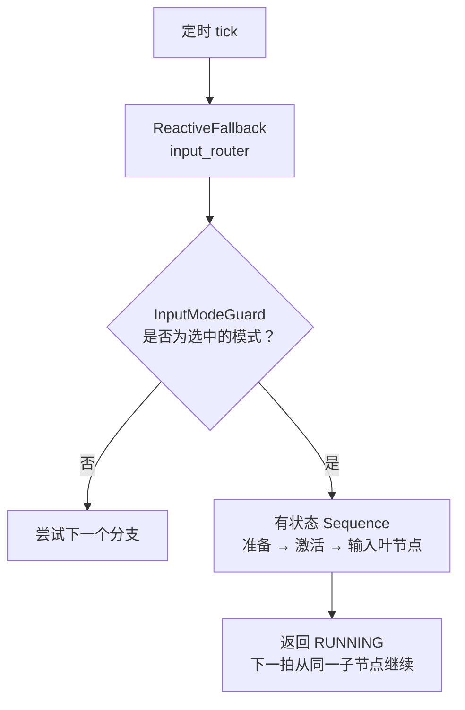

# 行为树节点参考

本页说明 `realman_bt` 行为树如何执行一拍、每个节点的作用、如何在 XML 中使用节点，以及如何新增节点。
模式切换的 ROS 契约见 [行为树控制权与 Mock](./behavior-tree-control)，policy 任务的阈值与排障见
[Policy 任务](./policy-task)，本页不再重复。

<Glance :items="[{ label: '生产树', value: 'control.xml' }, { label: '执行器', value: 'realman_bt_executor' }, { label: '节点注册', value: 'realman_bt_executor_node.cpp' }, { label: '端口来源', value: 'providedPorts()' }]" />

下面两个交互模块中的树结构取自 [`config/behavior-trees/control.xml`](https://github.com/QingTianRobot/realman_pi/blob/main/config/behavior-trees/control.xml)；
各节点的端口、默认值和说明在构建站点时从 C++ 的 `providedPorts()` 中提取（`website/scripts/bt-catalog.mjs`）。
因此代码或 XML 一旦修改，页面会随之更新。只有描述节点作用的文字是手写的，位于 `theme/bt/node-docs.ts`。

## 一拍的执行过程

执行器按 `config/ros/behavior_tree.yaml` 中的 `tick_rate_hz`，定时从根节点开始 tick 整棵树。每个节点被 tick 后返回以下三种状态之一：

| 状态 | 含义 |
| --- | --- |
| `SUCCESS` | 任务已完成 |
| `FAILURE` | 任务无法完成 |
| `RUNNING` | 仍在进行，下一拍继续 |

父节点根据子节点返回的状态决定下一步。组合节点分为两类，区别在于下一拍从哪个子节点开始：

- **有状态节点**（`Sequence`、`Fallback`）会记住正在运行的子节点，下一拍直接从该子节点继续。适合"先回位、再激活、再执行"这类按步骤推进的流程。
- **响应式节点**（`ReactiveSequence`、`ReactiveFallback`）每一拍都从第一个子节点重新评估，适合条件变化后需要立即切换的场景。输入路由的每个模式分支都以 `InputModeGuard` 开头：用户切换模式后，下一拍该 guard 就会失败，其后正在运行的分支随即被 `halt()`。

`halt()` 表示"停止执行"：父节点放弃一棵仍在 `RUNNING` 的子树时会调用它。叶节点必须在 `onHalted()` 中彻底停止自身（取消 Action、发出停止调用），并且要能承受重复调用。
`Repeat` 和 `Retry` 在每次重来之前同样会 `halt()` 子树，因此每次重试都从子树的第一个节点重新开始。



## 浏览整棵树

点击任意节点，可查看它的作用、返回值、`halt()` 行为、读写的黑板键以及端口表。端口表中，**本处取值**是该处 XML 写入的值（`{...}` 表示从黑板读取），**默认值**和**说明**来自 C++ 源码。
如果节点上方有 XML 注释（通常说明设计原因），也会一并显示。下方按类别列出执行器注册的全部节点，包括生产树未使用的调试节点。

<BtTreeExplorer />

## 逐拍查看 policy 任务

选择一个场景后点击"下一拍"，可以看到 policy 分支中各节点状态的变化、装饰节点的计数，以及写入黑板的内容。
模拟使用的子树就是上文 `control.xml` 中的 `policy_entry`。`Sequence`、`Fallback`、`Repeat`、`RetryUnlessFault` 的行为与 C++ 实现逐行对应，
只有叶节点的结果由场景脚本设定（例如"第一次抓空、第二次成功"）。为便于观察，模拟中每个叶节点只运行几拍；在真机上，一次尝试通常持续几十秒，即数百拍。

<BtTickSimulator />

有几个细节值得留意：

- 一次尝试失败后，`RetryUnlessFault` 在当拍只 `halt()` 子树并返回 `RUNNING`，下一拍才从 `GripperReady` 重新开始，因此每次重试都会先张开夹爪、再回位。
- 发生故障时（关节越界、执行了放置任务、夹爪无法张开），叶节点会把 `policy_fault` 置为 `true`。`RetryUnlessFault` 随即放弃剩余次数并返回失败，`Fallback` 转而执行 `FailInputMode`。
- 策略服务超时（桥接因推理连续超时而暂停、统计中断、预检时桥接未就绪）时，`PolicyRun` 置位 `policy_timeout`。`RetryUnlessFault` 把它记入单独的 `timeout_attempts` 次数，不占用 `num_attempts`，先等待 `timeout_backoff_sec`（模拟中缩短为两拍，真机上为 20 s），再从 `GripperReady` 重新开始。超时次数用完后，失败原因前会加上 `policy server timed out N times`。
- `FailInputMode` 不返回 `FAILURE`，而是保持 `RUNNING`，并把输入模式标记为 `FAILED`；协调器随后切换到 `none`，该分支也随之被 `halt()`。如果没有这个节点，持久路由会让失败的分支反复重来。
- 全部周期完成后，分支停留在 `PolicyInputStub`：此时桥接已停止，但控制权仍属于 policy，直到用户切换模式。

## 节点分类与设计约定

| 类别 | 节点 | 约定 |
| --- | --- | --- |
| 控制节点 | `Sequence`、`Fallback`、`ReactiveSequence`、`ReactiveFallback` | 只负责组合子节点，不调用 ROS |
| 装饰节点 | `Repeat`、`Retry`、`RetryUnlessFault`、`MotionDwellMonitor` | 只有一个子节点，重来或提前结束前先 `halt()` 它 |
| 条件节点 | `InputModeGuard` | 只读不写，从不返回 `RUNNING` |
| 动作节点 | 其余全部 | 叶节点：调用服务、Action 或话题，或表示某个输入正持有控制权 |

编写新节点或修改树时，请遵守以下约定；交互模块中的每个节点都按这些约定实现：

- **输入叶节点始终返回 `RUNNING`。** `KeyboardVelocityInput`、`PikaVelocityInput` 等叶节点在树中只表示"该输入正持有控制权"，实际指令由同一 launch 中的 router 进程转发。
- **先准备，再激活。** 需要准备动作的分支把 `ThreeArmMoveJ` 或 `PrepareKeyboardWork` 放在 `ActivateInputMode` 之前，并用有状态的 `Sequence` 包裹。这样准备失败时永远不会发布 `ACTIVE`；准备成功后也不会每拍重做，因为这些节点完成后会保持 `SUCCESS`，直到被 `halt()`。
- **区分可重试与不可重试的失败。** 抓空、超时等"再试一次可能成功"的失败，叶节点只需返回 `FAILURE`；越界、数据丢失等"重试也无济于事"的失败，叶节点要先把 `policy_fault` 置为 `true`，再返回 `FAILURE`；外部服务暂时没有响应、过一会儿可能恢复的失败，叶节点先把 `policy_timeout` 置为 `true`，由 `RetryUnlessFault` 单独计数并等待后重试。
- **会产生动作的叶节点都有 `dry_run` 端口**，默认为 `true`，此时只做校验和记录，不发送任何指令。生产树写作 `dry_run="{dry_run}"`，启动时由 `REALMAN_BT_DRY_RUN` 决定。
- **参数不写死在 XML 中。** 关节角、周期数等可能变化的值通过 `{key}` 从黑板读取，由 launch 从 YAML 注入，例如 `pika_default_pose` → `{pika_r_joint_degrees}`，`policy_task.yaml` → `{policy_cycles}`。

## 在 XML 中使用节点

端口值有两种写法：

```xml
<!-- velocity_percent 为字面量，直接写在 XML 中；r_joint_degrees 为黑板重映射，运行时读取 -->
<ThreeArmMoveJ name="policy_start_pose"
               velocity_percent="10"
               r_joint_degrees="{pika_r_joint_degrees}"/>
```

未填写的端口使用 C++ 中的默认值，即上方端口表的"默认值"一列。`name` 不是端口，只用于在监视器和日志中区分同类节点。
`InputModeGuard` 的 `mode`、`label`、`selectable` 必须是字面量：它们在节点构造时登记到模式目录，Web 选择器和
`list_input_modes` 都从该目录读取，因此新增模式只需修改 XML。

`PolicyRun` 的 `task` 端口用于选择 `policy_task.yaml` 中 `tasks` 下的某个任务，它决定发送给桥接的 prompt 以及成功的判定方式：
放入收纳盒按放手判定，纯抓起按抬起并保持判定。同一棵子树只需更换 `task` 即可执行另一种任务，无需新增叶节点，详见
[Policy 任务](./policy-task)。

## 新增节点

<Steps>

1. 在 `src/behavior/realman_bt/` 中编写节点类：继承 `bt_core::ActionNode`（或 `ConditionNode`、`DecoratorNode`），在 `providedPorts()` 中为每个端口填写默认值和一句说明（这段说明会直接显示在本页的端口表中），并在 `onHalted()` 中彻底停止自身。
2. 在 `realman_bt_executor_node.cpp` 中调用 `registerNodeType<节点类>("XML 标签")` 注册。
3. 编写测试：判定逻辑尽量放在不依赖 ROS 的类中做单元测试（参考 `PolicySupervisor`）；ROS 交互用模拟的服务和话题驱动（参考 `test_policy_run_node.cpp`）。测试文件开头加上 `#undef NDEBUG`，否则 Release 构建会移除 `assert`。
4. 在 XML 中使用该节点，并运行 `test_control_router_tree`（XML 契约测试）。
5. 在 `website/docs/.vitepress/theme/bt/node-docs.ts` 中添加说明：节点的作用、三种返回值的含义和 `halt()` 行为。站点 e2e 测试会检查每个注册节点都有说明，缺少时测试会失败。

</Steps>

修改节点、端口、Action/Service 接入或取消逻辑时，请遵循项目的
[行为树开发 Skill](https://github.com/QingTianRobot/realman_pi/blob/main/.agents/skills/developing-realman-behavior-trees/SKILL.md)。

## 验证

```bash
colcon build --symlink-install --packages-select realman_bt
colcon test --packages-select realman_bt
colcon test-result --verbose
cd website && npm run build && npm run test:e2e     # 本页的树、端口表和模拟
```
