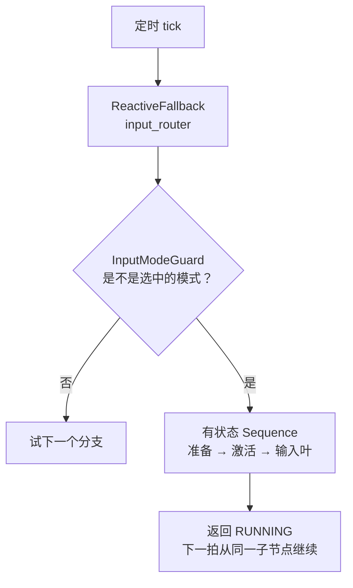

# 行为树节点参考

这一页讲清楚 `realman_bt` 行为树怎么"走一拍"、每个节点做什么、怎么在 XML 里用它们，以及怎么新增节点。
模式切换的 ROS 契约在 [行为树控制权与 Mock](./behavior-tree-control)，policy 任务的阈值与排障在
[Policy 任务](./policy-task)，这里不重复。

<Glance :items="[{ label: '生产树', value: 'control.xml' }, { label: '执行器', value: 'realman_bt_executor' }, { label: '节点注册', value: 'realman_bt_executor_node.cpp' }, { label: '端口来源', value: 'providedPorts()' }]" />

下面两个交互块里的树结构来自 [`config/behavior-trees/control.xml`](https://github.com/QingTianRobot/realman_pi/blob/main/config/behavior-trees/control.xml)，
每个节点的端口、默认值和说明在构建站点时从 C++ 的 `providedPorts()` 抽取（`website/scripts/bt-catalog.mjs`），
所以改了代码或 XML，页面跟着变；只有"这个节点做什么"的文字是手写的（`theme/bt/node-docs.ts`）。

## 一拍是怎么走的

执行器按 `config/ros/behavior_tree.yaml` 的 `tick_rate_hz` 定时从根节点 tick 一遍树。每个节点被 tick 后返回三种状态之一：

| 状态 | 含义 |
| --- | --- |
| `SUCCESS` | 这件事做完了 |
| `FAILURE` | 这件事做不成 |
| `RUNNING` | 还在做，下一拍再问我 |

父节点只看子节点的状态决定下一步。有两类组合节点，区别在"下一拍从哪里开始"：

- **有状态**（`Sequence`、`Fallback`）记住正在运行的子节点，下一拍直接从它继续。用于"先回位、再激活、再干活"这种一步接一步的流程。
- **响应式**（`ReactiveSequence`、`ReactiveFallback`）每一拍都从第一个子节点重新评估。用于"条件一变就立刻切走"：输入路由的每个模式分支都以 `InputModeGuard` 开头，用户换了模式，下一拍这个 guard 就失败，后面正在运行的分支被 `halt()`。

`halt()` 是"别做了"：父节点放弃一个正在 `RUNNING` 的子树时调用它。叶节点必须在 `onHalted()` 里把自己停干净（取消 Action、发停止调用），并且允许被重复 `halt()`。
`Repeat` 和 `Retry` 在每一轮重来之前也会 `halt()` 子树，所以重试总是从子树的第一个节点重新开始。



## 浏览整棵树

点任意节点看它的作用、返回值、`halt()` 行为、读写的黑板键，以及端口表：**本处取值**是这一处 XML 写的值（`{...}` 表示从黑板读），**默认值**和**说明**来自 C++ 源码。
节点上方的 XML 注释（为什么这样设计）也会显示出来。下面的芯片列出执行器注册的全部节点，包括生产树没用到的调试节点。

<BtTreeExplorer />

## 逐拍看 policy 任务

选一个场景，按"下一拍"看 policy 分支里每个节点的状态怎么变化、装饰节点怎么计数、黑板上写了什么。
子树就是上面 `control.xml` 里的 `policy_entry`；`Sequence`、`Fallback`、`Repeat`、`RetryUnlessFault` 的行为逐行对照了 C++ 实现，
只有叶节点的结局是场景脚本给定的（例如"第一次抓空、第二次成功"）。为了看得清，模拟里每个叶节点只跑几拍，真机上一次尝试是几十秒、几百拍。

<BtTickSimulator />

几个值得注意的细节：

- 一次尝试失败后，`RetryUnlessFault` 这一拍只 `halt()` 子树并返回 `RUNNING`，下一拍才从 `GripperReady` 重新开始，所以每次重试都会先张开夹爪、回位。
- 故障（"关节越界""跑成了放置任务""夹爪张不开"）会把 `policy_fault` 置为 `true`，`RetryUnlessFault` 不再消耗剩余次数，直接让 `Fallback` 走到 `FailInputMode`。
- `FailInputMode` 不返回 `FAILURE`，而是保持 `RUNNING`，把输入模式标成 `FAILED`；协调器接着切到 `none`，这个分支随之被 `halt()`。如果没有它，持久路由会把失败的分支一遍遍重来。
- 全部周期完成后分支停在 `PolicyInputStub`：桥接已经停了，但控制权仍属于 policy，直到用户换模式。

## 节点分类与设计约定

| 类别 | 节点 | 约定 |
| --- | --- | --- |
| 控制节点 | `Sequence`、`Fallback`、`ReactiveSequence`、`ReactiveFallback` | 只组合子节点，不碰 ROS |
| 装饰节点 | `Repeat`、`Retry`、`RetryUnlessFault` | 只有一个子节点；重来前 `halt()` 它 |
| 条件节点 | `InputModeGuard` | 只读不写，从不 `RUNNING` |
| 动作节点 | 其余全部 | 叶节点：调用服务、Action、话题，或代表"某个输入正拥有控制权" |

写新节点或改树时遵守这些约定，交互块里的每个节点都按它们实现：

- **输入叶一直 `RUNNING`。** `KeyboardVelocityInput`、`PikaVelocityInput` 这类叶节点在树里只代表"这个输入正拥有控制权"，真正的指令由同一 launch 里的 router 进程转发。
- **先准备，再激活。** 需要准备动作的分支把 `ThreeArmMoveJ` 或 `PrepareKeyboardWork` 放在 `ActivateInputMode` 之前，并包在有状态 `Sequence` 里：准备失败就永远不会发布 `ACTIVE`，准备成功后也不会每拍重做（这些节点完成后保持 `SUCCESS`，直到被 `halt()`）。
- **可重试和不可重试要分开。** 抓空、超时这类"再来一次可能就好"的失败，叶节点只返回 `FAILURE`；越界、数据丢失这类"再试也没用"的，先把 `policy_fault` 置为 `true` 再返回 `FAILURE`。
- **每个会动的叶节点都有 `dry_run` 端口**，默认 `true`：只校验和记录，不发任何指令。生产树写 `dry_run="{dry_run}"`，由 `REALMAN_BT_DRY_RUN` 在启动时决定。
- **参数不复制进 XML。** 关节角、周期数这类会变的值用 `{key}` 从黑板读，由 launch 从 YAML 注入（例如 `pika_default_pose` → `{pika_r_joint_degrees}`，`policy_task.yaml` → `{policy_cycles}`）。

## 在 XML 里使用节点

端口值有两种写法：

```xml
<!-- velocity_percent 是字面量，写死在这里；r_joint_degrees 是黑板重映射，运行时读 -->
<ThreeArmMoveJ name="policy_start_pose"
               velocity_percent="10"
               r_joint_degrees="{pika_r_joint_degrees}"/>
```

没写的端口用 C++ 里的默认值（上面端口表的"默认值"列）。`name` 不是端口，只用来在监视器和日志里区分同类节点。
`InputModeGuard` 的 `mode`、`label`、`selectable` 必须是字面量：它们在构造时就登记进模式目录，Web 选择器和
`list_input_modes` 都从这里读，所以新增一个模式只改 XML。

`PolicyRun` 的 `task` 端口选择 `policy_task.yaml` 里 `tasks` 下的一个任务：它决定发给桥接的 prompt 和"怎样算成功"
（放进收纳盒是放手判定，纯抓起是抬起并保持）。同一个子树换一个 `task` 就是另一种任务，不需要新的叶节点；细节见
[Policy 任务](./policy-task)。

## 新增一个节点

<Steps>

1. 在 `src/behavior/realman_bt/` 写节点类：继承 `bt_core::ActionNode`（或 `ConditionNode`、`DecoratorNode`），在 `providedPorts()` 里给每个端口写上默认值和一句说明（这段说明会直接出现在本页的端口表里），在 `onHalted()` 里把自己停干净。
2. 在 `realman_bt_executor_node.cpp` 里 `registerNodeType<你的类>("XML 标签")`。
3. 写测试：判定逻辑尽量放在不依赖 ROS 的类里单测（参考 `PolicySupervisor`），ROS 交互用假的服务和话题驱动（参考 `test_policy_run_node.cpp`）。测试文件开头加 `#undef NDEBUG`，否则 Release 构建会删掉 `assert`。
4. 在 XML 里使用它，并跑 `test_control_router_tree`（XML 合同）。
5. 在 `website/docs/.vitepress/theme/bt/node-docs.ts` 加一条说明：它做什么、三种返回值、`halt()` 行为。站点的 e2e 测试会检查每个注册节点都有说明，漏了会失败。

</Steps>

改节点、端口、Action/Service 接入或取消逻辑时，按项目的
[行为树开发 Skill](https://github.com/QingTianRobot/realman_pi/blob/main/.agents/skills/developing-realman-behavior-trees/SKILL.md) 走。

## 验证

```bash
colcon build --symlink-install --packages-select realman_bt
colcon test --packages-select realman_bt
colcon test-result --verbose
cd website && npm run build && npm run test:e2e     # 本页的树、端口表和模拟
```
